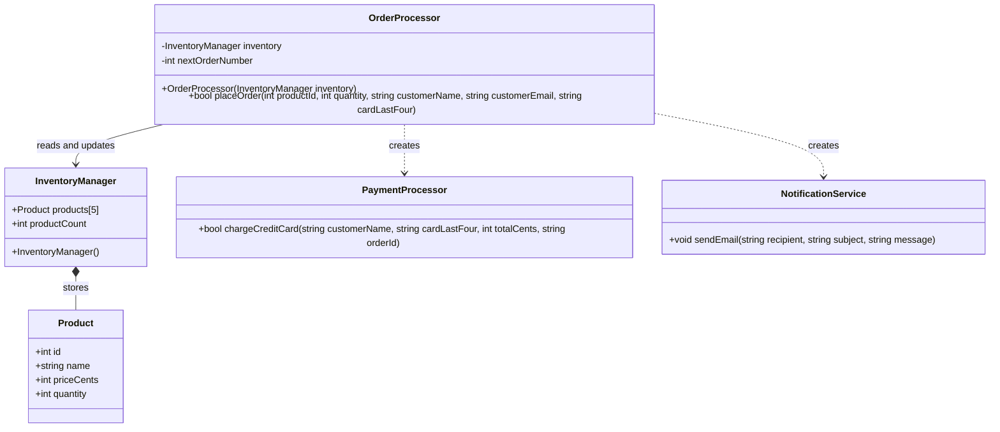

# StoryMcStoreface

StoryMcStoreface is a small C++ console application for viewing inventory and placing simulated orders. Payments are recorded as local IOU files; no real payment is processed. Checkout supports fake credit cards, promo codes, and store credit.

## Getting Started

### Prerequisites

- A C++ compiler with C++17 support
- GNU Make

This project is compatible with [cpp-container](https://github.com/ChicoState/cpp-container) docker container. If you already have the container built, just run:

```sh
docker run -v "$(pwd)":/usr/src -it cpp-container
```
And that will build and run the application.

### Manual Build

From the project directory, run:

```sh
make
```

This compiles the application with C++17 and creates the `storymcstoreface` executable.

### Manual Run

Start the application with:

```sh
make run
```

The menu allows you to view inventory, place an order, or exit. When an order is placed, a simulated payment receipt is written to the `payments/` directory.

### Payment demos

- Credit card: provide any non-empty fake last four digits.
- Promo code: `THANKYOU25` covers one order of up to $25.00 per customer email.
- Store credit: `storecredit@example.com` starts with $50.00 of in-memory credit.

Promo redemptions and store-credit balances reset whenever the application exits.

###  Manually Clean Build Artifacts

To remove the executable, object files, and dependency files:

```sh
make clean
```

## Build Targets

| Command | Description |
| --- | --- |
| `make` or `make build` | Build the application |
| `make run` | Build, then launch the application |
| `make test` | Run payment behavior tests |
| `make clean` | Remove generated build artifacts |
| `./test_runner.sh` | Build and run the interactive program |

## Roadmap

The current class relationships are represented below. The diagram also highlights the direct dependencies that are candidates for future decoupling.



Planned improvements include encapsulating inventory storage, injecting payment and notification interfaces into `OrderProcessor`, and isolating payment persistence behind a repository abstraction.
